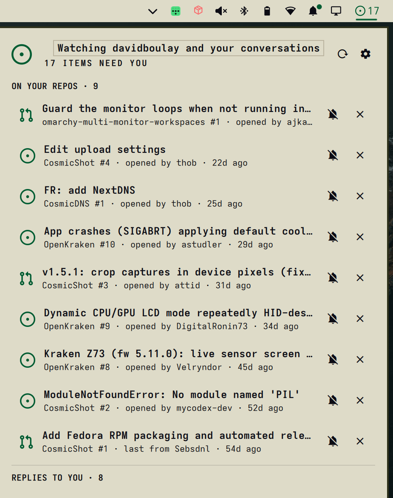

# Maintainer Inbox

Every open issue and pull request on the GitHub repositories you maintain, plus replies in your conversations anywhere on GitHub, in the Omarchy bar until you've answered.



GitHub notifications can't promise that. They only exist for repositories you watch at the right level, and anything marked read on your phone, by email or on the web disappears from them. This widget skips notifications and asks GitHub search directly: `is:open archived:false user:<you>`.

## What counts as "needs you"

An item needs you when someone else was active on it (opened it, commented, reviewed, or pushed a commit) more recently than you were. Bot comments, reviews and commits (CI summaries, AI reviewers, rebase bots) never count as a reply.

It shows two groups:

- **On your repos:** open issues and PRs on repositories you own, and on any extra owners or repositories you add (for example a work organization, `lojel`, or a single repository, `lojel/lojel-wp`).
- **Replies to you:** issues and PRs anywhere on GitHub that you opened, commented on, or were mentioned or assigned in, once someone answers after you. This covers your upstream PRs and bug reports. You can switch it off in settings.

| State | Meaning | Leaves when |
|---|---|---|
| **Needs you** | Their move is the latest | You reply on GitHub, or press `d` |
| **Waiting on them** | Your reply is the latest | They answer, which brings it back |
| **Dismissed** | You set it aside with `d` | Any new outside activity brings it back |
| **Muted** | You're done with it (`m`) | Never, until you unmute it |

Your own issues only show up once someone else has commented on them.

## Alerts

- Each new item or reply sends a desktop notification. Clicking it opens the item on GitHub. When more than three arrive at once, you get a single summary instead.
- The bar shows the count in the urgent color.
- If GitHub can't be reached for an hour (configurable), the bar turns urgent and shows `!`, so silence never hides a failed check.

To check that clicking a notification opens the item: `omarchy-shell io.github.davidboulay.maintainer-inbox testNotification`.

## Requirements

`gh` logged in (`gh auth login`, with `repo` scope for private repositories), and `python3`. No token is read or stored. gh installed through mise is found even when it isn't on the shell's PATH.

## Install

```bash
omarchy plugin add https://github.com/davidboulay/omarchy-maintainer-inbox.git --enable
```

Settings: the gear in the panel, or `omarchy bar set io.github.davidboulay.maintainer-inbox <key> <value>`. The keys are `refreshIntervalMin` (5), `owners` (extra owners or `owner/repo` entries, comma-separated), `participating` (on), `excludeBots`, `notify`, `hideWhenEmpty` and `staleAfterMin` (60).

State (what has already been notified, and dismissals) lives in `~/.local/state/omarchy-maintainer-inbox/state.json`.

Keys in the panel: `j`/`k` select · `enter` open · `d` dismiss/restore · `m` mute/unmute · `w` waiting · `h` dismissed · `u` muted · `r` refresh · `,` settings.

## Remove

```bash
omarchy plugin remove io.github.davidboulay.maintainer-inbox
rm -rf ~/.local/state/omarchy-maintainer-inbox
```

MIT licensed.
